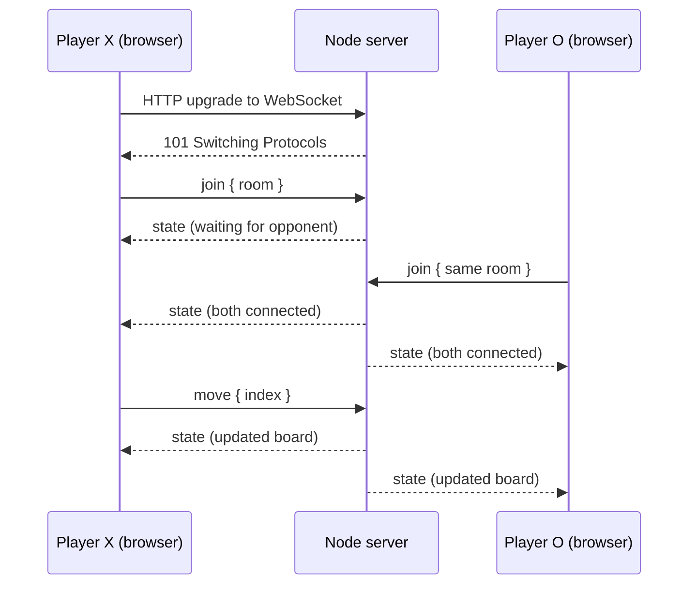

# Real-Time Tic-Tac-Toe

A two-player Tic-Tac-Toe game built with **React**, **TypeScript**, **Node.js** and raw **WebSockets** (the [`ws`](https://github.com/websockets/ws) library, no Socket.IO).

Two players join the same room code and play in real time. The server owns the game state and validates every move; the browser only sends moves and renders what the server broadcasts.

> This is a learning project for understanding how WebSockets work end to end: the HTTP upgrade handshake, a stateful server, a JSON message protocol, and the client connection lifecycle.

## Features

- Room codes: any two players who enter the same code are paired as X and O.
- Authoritative server: turn order, occupied cells, bounds and game-over checks all happen on the server.
- Live updates pushed to both players the instant a move is made, with no polling.
- Win, draw and "play again" handling.
- Opponent presence: the UI shows "Waiting for opponent..." if the other player disconnects.
- Light and dark mode.

## Tech stack

| Part | Technology |
| --- | --- |
| Client | React, TypeScript, Vite |
| Server | Node.js (ES modules), `ws` |
| Hosting | Render (WebSocket server and static client) |

## Project structure

```text
.
├── client/                 React + Vite app
│   ├── public/
│   ├── src/
│   │   ├── App.tsx         Join screen, board, WebSocket lifecycle
│   │   └── App.css
│   ├── index.html
│   ├── package.json
│   ├── tsconfig.json
│   └── vite.config.ts
├── server/                 Node WebSocket server
│   ├── server.js           Rooms, move validation, broadcasting
│   └── package.json
└── .gitignore
```

`client` and `server` are two independent projects with their own `package.json`. They are hosted separately and are connected only by the WebSocket URL.

## How it works



- The server keeps rooms in memory as `roomId -> { board, turn, X, O }`, where `X` and `O` are the connected sockets.
- After every change, the server sends each player the shared state plus their own symbol (`you`).
- The client opens its socket in a `useEffect` keyed on the room and closes it in the cleanup function.

## Message protocol

All messages are JSON objects with a `type` field.

**Client to server**

| Type | Payload | Purpose |
| --- | --- | --- |
| `join` | `{ room: string }` | Join (or create) a room |
| `move` | `{ index: number }` | Place a mark in a cell, `0` to `8` |
| `reset` | none | Start a new game in the same room |

**Server to client**

| Type | Payload | Purpose |
| --- | --- | --- |
| `state` | `{ board, turn, winner, draw, opponentConnected, you }` | Current game state |
| `error` | `{ message }` | A rejected action, such as "Not your turn" |

The server rejects invalid JSON, a full room, moves out of turn, moves on occupied cells, out-of-range cells and moves after the game has ended.

## Run locally

Prerequisites: a current LTS version of Node.js and npm.

### 1. Start the server

```sh
cd server
npm install
npm start
```

The server listens on port `8080` unless the `PORT` environment variable is set.

### 2. Start the client

Create `client/.env.local`:

```env
VITE_WS_URL=ws://localhost:8080
```

Then, in a second terminal:

```sh
cd client
npm install
npm run dev
```

Open the URL printed by Vite (usually `http://localhost:5173`) in **two browser tabs**, enter the same room code in both, and play.

### Inspect the connection

In Chrome DevTools, open **Network**, filter by **WS**, and select the connection to your server:

- **Headers** shows `101 Switching Protocols`, the HTTP-to-WebSocket upgrade.
- **Messages** shows each frame live: up arrows are sent (`join`, `move`), down arrows are received (`state`, `error`).

Vite also opens its own WebSocket on port `5173` for hot reloading. That one is separate from the game connection.

## Deployment

The server and the client are deployed as two separate Render services.

### Server: Render Web Service

| Setting | Value |
| --- | --- |
| Root Directory | `server` |
| Build Command | `npm install` |
| Start Command | `npm start` |
| Instance Type | Free |

Deployed backend:

- Service URL: https://real-time-updates-1.onrender.com/
- WebSocket URL used by the client: `wss://real-time-updates-1.onrender.com`

Opening the service URL in a browser shows an "Upgrade Required" style response rather than a web page. That is expected: the server only speaks WebSocket.

### Client: Render Static Site

| Setting | Value |
| --- | --- |
| Root Directory | `client` |
| Build Command | `npm run build` |
| Publish Directory | `dist` |
| Environment variable | `VITE_WS_URL=wss://real-time-updates-1.onrender.com` |

Vite embeds `VITE_` variables at build time, so redeploy the client after changing `VITE_WS_URL`. Use `wss://` (not `ws://`) for the deployed client, because browsers block insecure WebSockets from HTTPS pages.

## Known limitations

- **Free-tier sleep:** a free Render service spins down after a period of inactivity, so the first connection after idle time can take a while.
- **In-memory state:** rooms live in server memory and are lost on restart or redeploy. Running multiple server instances would need shared state, such as Redis pub/sub.
- **No reconnection:** refreshing the page gives up your seat.
- **No heartbeat:** dead connections are only detected when the TCP connection closes.

## Ideas for next steps

- Reconnect with a persistent player ID so a refresh keeps your seat.
- Ping/pong heartbeats to detect dead connections.
- Convert the server to TypeScript and share message types with the client.
- Unit tests for the win and draw logic, plus integration tests using `ws` clients.
- Origin checks and basic rate limiting on the server.
